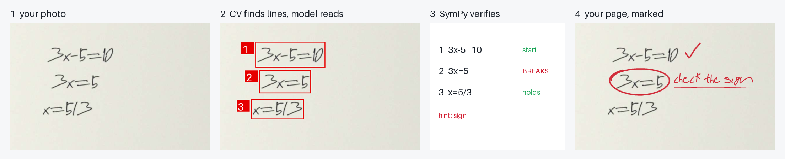

# RedPen: your algebra, marked like a teacher would

**Live:** https://redpen-banana-hacks.vercel.app · **Built for Banana Hacks 2026 (Image AI)** · solo

Take a photo of a handwritten algebra solution. RedPen gives you **your own page back, marked in red pen**:
ticks on lines that hold, a circle on the **first line that breaks**, and a short hint written in handwriting
("check the sign", "lost a solution"). It never writes the answer.

> Photomath gives you the answer. RedPen shows you where **your** work went wrong, on your own page.



## Why
A student doing homework without a tutor has two bad options. An answer key tells them *that* they are wrong, not *where*.
A solver app or chatbot gives away the whole solution. A teacher marks the first line that breaks and stops there.
RedPen does that from a phone photo.

## Image in, image out
The input is a photo of handwriting and the output is that same photo with red ink on it. Without the vision stages there
is no product: you would have to retype every line yourself, and you would get a list instead of your marked page.

| Stage | What happens | Why |
|---|---|---|
| 1. Find lines | Classical computer vision (background division, ruled-line removal, deskew search, projection profile) boxes each written line. If those boxes do not look like lines of handwriting (28 of our 30 real answer-sheet crops), the vision model locates the lines instead. Sideways photos are turned upright. | Every line gets a stable box and number. |
| 2. Read | A vision model reads the page with numbered boxes drawn on it (set-of-mark prompting) and copies each line *exactly, mistakes included*. Word lines are labelled as prose. | The model transcribes. It never decides what is right. |
| 3. Verify | **SymPy** checks each line against the previous readable one: solution sets for equations (so `x²=3x → x=3` is a *lost solution*), symbolic + random-point identity for expressions, chains like `a = b = c` checked inside the line, answer checks like `3(5)-5=10` evaluated, rounded decimals accepted to the precision written. | Correctness is decided by a maths engine, the same way every time. |
| 4. Read twice before accusing | Before circling a line, RedPen reads that line and the one before it **a second time, cropped and enlarged**. If both readings put the slip on the same line, it circles it. If the two readings disagree, it does **not** accuse: it marks the line with a "?" and asks the student to check it. | A misread must never look like a student mistake, and a "corrected" re-read must never erase a real one. |
| 5. Classify | The hint names the kind of slip (sign, arithmetic, distribution, missing term, lost / extra solution) by testing which *single plausible mistake* applied to the previous line gives the student's line. | A hint, not the answer. |
| 6. Point at the term (vision grounding) | SymPy finds which single written term would have to be different for the step to hold (e.g. the `10` in `2x+3=7 → 2x=10`), and the vision model is asked where that term sits inside the line (box grounding on an enlarged crop). If it finds it, only that term is circled; otherwise the whole line is. On the 150 synthetic pages, 76 of the 103 accusations were narrowed to a term (where it lands was checked by eye on our demo pages only, not measured). | The circle lands where a teacher's would, without saying what the term should be. |
| 7. Mark | The verdict is drawn on the student's photo in red ink. The margin note is **handwriting built from real human pen strokes** (Google MathWriting glyphs), not a font. | The output is your page, marked. |

Edit any line RedPen misread, or fix your own work, and press **Re-check my fix**: it re-verifies and re-draws on your photo in about a second.

## Results (measured, not claimed)
Produced by `python -m eval.run …`. Raw rows are in `eval/results/`. "Same model asked directly" = the same vision model,
given the same photo, asked for the number of the first wrong line (`eval/run.py`, `BASELINE_PROMPT`).
Reader for both: `gemma-4-26b-a4b-it`, the first model the live site uses. Synthetic pages = generated solutions (5 templates, 3–5 lines) written with real human pen strokes, a quarter of them with paper texture, tilt and blur. Real pages = crops of phone photos of students' answer sheets (`eval/make_real_crops.py`, labels in `eval/real/labels.json`).

<!-- results:start -->
| | synthetic pages (n=150: 108 with a slip, 42 correct) | real pages (n=30: 12 with a slip, 18 correct) |
|---|---|---|
| **Right answer about the page**, RedPen | 139/150 = 93 % (87–96) | 26/30 = 87 % (70–95) |
| Right answer about the page, same model asked directly | 114/150 = 76 % (69–82) | 21/30 = 70 % (52–83) |
| First slip found on the right line, RedPen | 100/108 = 93 % (86–96) | 10/12 = 83 % (55–95) |
| First slip found on the right line, same model asked directly | 91/108 = 84 % (76–90) | 8/12 = 67 % (39–86) |
| **Correct pages wrongly accused**, RedPen | 3/42 = 7 % (2–19) | 2/18 = 11 % (3–33) |
| Correct pages wrongly accused, same model asked directly | 19/42 = 45 % (31–60) | 5/18 = 28 % (12–51) |
| Pages where RedPen pointed at a wrong line / same model asked directly | 3 / 27 | 2 / 8 |
| Pages where RedPen asked "?" instead of accusing | 6 | 3 |
| Paired comparison (pages only RedPen got right / only same model asked directly got right, exact McNemar p) | 32 / 7, p < 0.001 | 8 / 3, p = 0.227 |

Percentages with 95 % Wilson intervals in brackets.
<!-- results:end -->

**Stronger baselines.** Judges asked whether a better prompt closes the gap. We tried two (`eval/baseline_reasoned.py`):

<!-- reasoned:start -->
| Same vision model (gemma-4-26b), same image… | Right about the page: 150 synthetic | Right: 30 real | Correct pages wrongly accused: synthetic / real | States the correct answer (synthetic, wrong solutions) | RedPen better / worse on (paired, synthetic) |
|---|---|---|---|---|---|
| asked for the first wrong line | 114/150 = 76 % (69–82) | 21/30 = 70 % (52–83) | 19/42 = 45 % / 5/18 = 28 % | — (gives only a number) | 32 / 7, p < 0.001 |
| told to copy every line and reason step by step | 137/150 = 91 % (86–95) | 24/30 = 80 % (63–90) | 5/42 = 12 % / 1/18 = 6 % | 13 of 66 (hand-checked; 20 by the automatic check) | 10 / 8, p = 0.815 |
| …and told **not** to reveal the answer | 117/150 = 78 % (71–84) | 22/30 = 73 % (56–86) | 10/42 = 24 % / 3/18 = 17 % | 1 of 66 (automatic check) | 29 / 7, p < 0.001 |
| **RedPen** | **139/150 = 93 % (87–96)** | **26/30 = 87 % (70–95)** | **3/42 = 7 % / 2/18 = 11 %** | **0** (hints never contain a number — tested) | |
<!-- reasoned:end -->

A careful prompt matches RedPen's accuracy, but its explanation states the answer. Telling it not to reveal the answer
fixes that and costs accuracy (significantly, on synthetic pages). **Only RedPen gets both:** the accuracy of the best prompt
and no answer given away, because the decision is made by SymPy and the hints are fixed phrases. The answer-leak check is
`eval/answer_leak.py` (a leak = the explanation states the correct final value; the hand-checked list is in
`eval/results/…-answer-leak-handcheck.json`).

* **Verifier alone** (`python -m eval.verifier_eval`): 400 generated solutions with one injected slip each (or none). First-slip accuracy 100 %, false alarms 0 %, hint accuracy 98.6 %. This only shows the verifier is correct on clean text. The generator and the verifier share no code, but they were written by the same team, so this is a unit test, not a real-world number.
* **Line finding** (`tests/test_segmenter.py`): 97.7 % of ground-truth lines found with IoU ≥ 0.5 on 40 synthetic pages (98.7 % on the 24 pages the CI test uses).
* **Latency** on the live site (free-tier model, so it varies): 12.5 s and about 25 s for two uploads of a notebook-page photo this evening. One request took 52 s before the reader order and the hedged backup were added.

## Similar tools, and what is different
| Tool | What it does | Photo of paper? | Who decides "wrong"? | Marks the student's own page? |
|---|---|---|---|---|
| Photomath / Gauth / Microsoft Math Solver | Solve a problem from a photo, show steps | yes | the app's own solution | no, gives the solution |
| ChatGPT Study Mode / Khanmigo | Tutor chat; you can upload a photo of your work | yes | a language model | no, text reply |
| [Untangled](https://devpost.com/software/untangled-mj5dy7) (BigRed//Hacks 2026 winner) | Vision model transcribes, SymPy checks, first wrong turn flagged | no, digital whiteboard | SymPy | on the whiteboard |
| [Snap-a-Mistake](https://devpost.com/software/snap-a-mistake) (2026) | First wrong step from a photo, misconception label | yes | a language model | beside the line |
| Goodnotes 6 Math Assistance (2023) | Red underline on a wrong equation | no, in-app ink | the app | in the app |
| US patent 9773428 (2012) | Colours tablet handwriting steps by algebraic equivalence | no, tablet | algebra engine | tablet only |
| FERMAT benchmark (ACL 2025, arXiv 2501.07244) | Measures vision-language models at finding errors in handwritten maths | yes | (benchmark) | no |

**What only RedPen does, as far as we found:** it takes a **photo of paper**, lets a **symbolic engine** (not a language model) decide
the first wrong line, **refuses to accuse when two readings disagree**, and gives the student **their own photo back marked in red pen**.
Line-by-line equivalence checking itself is not new (the 2012 patent above and Untangled already do it); the photo-in, marked-photo-out loop
with a read-twice rule is what we built this weekend.

## Run locally
```bash
python -m venv .venv && .venv/bin/pip install -r requirements-dev.txt
.venv/bin/python -m pytest -q                 # all tests, no network
GEMINI_API_KEY=... .venv/bin/python tools/dev_server.py 8787   # http://127.0.0.1:8787
```
Architecture (Clean Architecture, dependencies point inward):
`redpen/domain` (algebra, verdict, markup plan; pure Python + SymPy) ← `redpen/application` (use cases, ports) ←
`redpen/adapters` (segmenter, vision reader with hedged fallback, renderer, orientation) ← `redpen/infrastructure` (JSON service, HTTP). See `SPEC.md`.

## Limitations (honest)
* Scope: single-variable linear and quadratic equations, expression simplification, arithmetic chains. Calculus, matrices, inequalities and geometry are reported as "not checked", never as wrong.
* A misread that is the same in both readings (for example an 8 read as a 4 twice) can still produce a wrong circle. Every read line is shown and can be edited.
* Real-photo evaluation is small: 30 crops from 20 phone photos of grade-9 answer sheets. 7 were used while building (orientation and verifier rules were tuned on them). The other 23 were labelled by a separate Claude agent that only looked at the photos (it never saw RedPen's output), after those rules were frozen; one parsing change (the angle sign ∠) went in with that set, before it was evaluated. After seeing the held-out results we fixed one more rule (substitution chains like `a+b+c = 18+10+c = 42`), which changed one held-out page from wrong to right: frozen 18/23, now 19/23; both files are in `eval/results/` (`real-…-frozen.json`). A trivial "it's all correct" answer would get 14/23. On real crops the paired difference against the naive prompt is not significant yet (p ≈ 0.2–0.4).
* The real answer-sheet crops come from a public Hugging Face dataset with no licence stated, so those images are **not** in this repo or the demo, only our labels and results.
* Sideways photos without EXIF data are assumed to be rotated one way (true for the 4 real sheets we tested). Phone photos with EXIF data are oriented correctly.
* The live site uses free vision-model quotas. If they run out, the samples and the edit-and-re-check flow keep working.
* The demo samples are replays of a real model run (recorded once by `tools/record_samples.py`), so they open instantly. Uploading your own photo runs live.

## Credits & AI use
* **Generative AI at runtime:** Google **Gemma 4** (`gemma-4-26b-a4b-it`) as the line reader, with Google **Gemini** flash-lite models as hedged backups, through the Gemini API.
* **Generative AI for building:** most of the code, tests and this README were written by **Claude (Anthropic) through Claude Code**, working under the author's direction during the hacking window. The idea was planned before the event; all code, data files and media were created inside the hacking window (see the commit history).
* **Data:** Google MathWriting (CC BY-NC-SA 4.0): human glyph strokes for the handwriting renderer, the sample pages and the synthetic test pages (`data/README.md`). The sample images in `public/samples/` and `public/hero.jpg` are derived from it and carry the same licence.
* **Libraries:** SymPy, NumPy, Pillow. Hosting: Vercel.
* Code: MIT. `data/glyphs.json`, `public/samples/*`, `public/hero.jpg`: CC BY-NC-SA 4.0.
